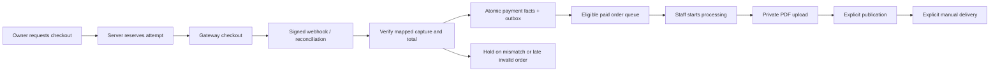

# Phase 5 payment architecture proposal

Status: design only, 3 November 2026. No gateway selected or installed; no payment endpoints, migrations, credentials, confirmations or deployment introduced. All table, column, route and role names below are proposals. Existing authentication and database security remain unchanged.

## Phase 4 readiness and retained fixtures

Reviewed PROGRESS.md and `test-results/live-documents-4d554701-fe9a-44b4-82d1-d0ed72097b34.json`: 40 actual development integration assertions passed, zero failed. These are distinct from the 104 isolated PGlite assertions and mocked browser tests.

A fresh, verified-TLS, read-only PostgreSQL transaction confirmed:

| Fixture | Current state |
| --- | --- |
| `DT-TEST-4D554701-PAID` | Correct owner and exact synthetic run marker; paid fixture; processing after withdrawal; one PDF version, zero available published versions |
| `DT-TEST-4D554701-UNPAID` | Correct owner and exact synthetic run marker; awaiting payment/not started; zero documents |
| Synthetic staff | Role revoked; no active staff grant |
| All three synthetic users | Banned, matching run metadata, zero Auth sessions and zero unrevoked refresh tokens |

This confirms current database/Auth access state; no passwords were recovered and no token was reconstructed. Sanitized evidence: `test-results/phase5-fixture-review.json`. Do not equate sign-out with cryptographic invalidation of every already-issued JWT: access tokens can remain valid until expiry. The integration runner kept tokens only in process memory and did not persist them, so this review does not replay an old token. For future sensitive payment operations, require a current session (including an existing `session_id` where immediate sign-out enforcement is required), not signature validation alone. [Supabase session lifecycle](https://supabase.com/docs/guides/auth/sessions).

Retain records. Dependencies include two drafts, two flight-sector rows, two passenger rows, two contacts, four audit events and one private Storage object linked to the withdrawn document. Order/user deletion could cascade through some relationships and conflict with document/audit references. Any future cleanup needs a separate dependency/retention review, exact fixture UUID allowlist, Storage API handling and explicit scope; never bulk-delete by email prefix or reference prefix. No deletion or remote mutation was performed for this architecture task.

The synthetic paid order is not a gateway payment. Do not fabricate a provider reference, ledger credit or receipt for it. A future additive migration should explicitly classify these reviewed UUIDs as synthetic test fixtures; production must exclude them from collection, reconciliation, financial totals and fulfilment eligibility. Do not infer fixture status from editable user metadata in production. Development counts currently include the retained orders.

## Existing foundation and constraints

- `public.orders` already stores immutable booking/price/policy snapshots, owner, reference, integer `unit_price_minor`/`total_minor`, passenger count, INR currency and an order-creation idempotency key. That key deduplicates order creation; it is not a gateway payment key.
- Current `payment_status` allows `awaiting_payment` and `paid`. `fulfilment_status` separately allows `not_started`, `processing`, `documents_ready`, `delivered`. The `unpaid_no_fulfilment` constraint requires payment to be paid for any later fulfilment state.
- Customer order RPCs calculate prices using the private catalog and reject drift against application prices/policy. Customers have no direct order-write privileges.
- `admin_order_action` requires active staff and verified payment for fulfilment/document mutations. `authorized_order_document` checks verified identity, paid status and either staff preview or ownership plus publication/non-withdrawal. Storage transport has a separate server-only secret.
- There are no gateway transactions, checkout attempts, webhook inbox, refund ledger or payment-confirmation API today. The existing `order_audit` requires a staff actor and has a fixed event vocabulary; machine payment events need a separate audit stream.

The stored preview policies explicitly say payments are disabled. Before accepting money, publish approved payment/refund/service terms, introduce a new catalog policy version through a new migration, and require explicit customer acceptance. Never rewrite historical accepted snapshots. Recommend creating a newly reviewed order for old preview orders whose terms/dates are no longer payable; do not silently collect against their old policy.

## Recommended data structure

Use additive migrations in the existing `booking_private` schema for sensitive payment records. Enable RLS with no client policies, revoke PUBLIC/anon/authenticated table privileges explicitly, and expose only narrow authorized summaries. Preserve owner/staff security on `public.orders`. Use `timestamptz`, integer minor currency amounts with bounds, and opaque UUIDs. JavaScript must reject unsafe integer conversions; never calculate money with floating-point rupees.

| Proposed record | Purpose and key fields |
| --- | --- |
| `payment_provider_accounts` | Provider code, merchant account identifier, `test`/`live` mode, enabled flag, configured API version and secret-manager key references only. No secret values. Composite identity scopes every external reference. |
| `payment_attempts` | One local checkout initiation: UUID, order FK, provider-account FK, attempt number, client request idempotency key, request fingerprint, immutable amount/currency, terms version, provider checkout/order/intent ID, state, creation/expiry/reconciliation timestamps, safe failure code. One order can have multiple attempts. |
| `payment_transactions` | One provider payment/charge: UUID, attempt/order FKs, provider payment ID, raw provider status plus normalized status, gross authorized/captured amounts, currency, provider timestamps, last verified timestamp and verification source. A provider checkout/order may generate several payment transactions; do not assume one attempt equals one charge. |
| `payment_webhook_events` | Durable verified inbox: provider-account FK, external event ID, event type, referenced object IDs, source time, received time, payload hash, signature key-version reference, processing state, retry count, lease/next-retry timestamps and sanitized error code. |
| `payment_movements` | Append-only confirmed capture/refund/reversal facts: transaction/refund FK, movement type, amount/currency, provider movement ID and source event/reconciliation evidence. Unique business movement prevents a second event ID from crediting the same capture twice. This is an operational payment ledger, not a replacement for statutory accounting. |
| `payment_refunds` | One refund operation: UUID, transaction/order FKs, requested amount/currency, reason code, request/approval actor and timestamps, idempotency key/fingerprint, provider refund ID, state, reserved amount, confirmed amount and safe error code. Multiple partial refunds are supported. |
| `payment_disputes` | Provider dispute ID, associated transaction, state, disputed amount and verified updates. Separate dispute lifecycle; never rewrite a capture as a failed attempt. |
| `payment_outbox` | Transactional work items for reconciliation, fulfilment eligibility changes and later authorized notifications. Unique effect key, payload containing IDs only, lease/retry state. Worker claims and retries work durably. |
| `payment_audit` | Immutable machine/staff event history: event category, source kind, source ID, nullable staff actor, order ID and safe transition details. Never invent a staff actor for a webhook. |

Proposed order summary additions: `accepted_payment_transaction_id`, `paid_at`, verified captured/refunded amounts, `refund_status`, pending-refund amount, `payment_review_status`, and eligibility hold reason. These are processor-maintained projections, never editable customer/admin fields. Snapshot price remains the collection target; gateway fees and settlement net amounts must not change it.

Key constraints:

- Unique attempt number per order, and unique client idempotency key per order. Reusing a key with a different fingerprint fails.
- Unique provider order/intent, payment, refund and event references within `(provider, merchant account, mode)`. Nullable external IDs become mandatory once a provider object is confirmed. An attempt belongs to exactly one order; enforce transaction/refund relationships with matching FKs/composite constraints, not just application assertions.
- Serialize payable-attempt creation with an order lock; normally reuse one active checkout. Ambiguous provider creation must be reconciled before another chargeable checkout is created.
- Record every actual capture, including accidental second captures. Never constrain the database to discard evidence of a second charge. Select only one exact full payment as the order's accepted payment; excess/second captures trigger a hold and reconciliation/refund workflow, never duplicate fulfilment.
- Under transaction/order locks, successful plus reserved in-flight refunds must not exceed the refundable captured balance. Unknown provider outcomes retain their reservation until reconciled.
- Use restrictive financial-record retention/FKs for new records. Do not cascade-delete payment evidence with an order/account; define pseudonymization and retention with the business before implementation.

## Trust boundaries and proposed routes

Customer-facing checkout uses a fresh verified Supabase session, same-origin checks, ownership authorization, bounded inputs and rate limits. Read amount/currency/terms from the server's immutable payable order; ignore client amount and payment status. Reject already-paid, held, synthetic/legacy-preview or expired/unfulfillable orders. Date/terms validity is revalidated before taking payment; changed requirements require renewed review, not silent repricing.

Use hosted checkout/provider-owned payment inputs. Keep PAN, CVV, banking credentials, passport data, DOB and passenger lists outside payment tables, URLs and logs. Send only required payer information and opaque order/attempt IDs to the provider. Document any new payer-data collection before enabling it. Checkout/browser identifiers are capabilities, not evidence that payment succeeded.

| Proposed route/service | Authority |
| --- | --- |
| `POST /api/orders/[orderId]/payment-attempts` | Owner session; creates/reuses a checkout using trusted order totals. No success mutation from browser input. |
| `GET /api/orders/[orderId]/payment` | Owner or freshly authorized staff; filtered status summary with no-store headers. |
| Browser return/callback | Shows “verifying payment”; validates any provider callback proof server-side and requests reconciliation. Redirect parameters/SDK success/screenshots never mark paid. |
| `POST /api/payments/webhooks/[provider]` | Provider signature authentication over raw bytes, not a customer session. This deliberately does not use the existing browser Origin/CSRF check; it has its own signature, bounded-body and rate controls. |
| Internal payment worker | Dedicated server identity with only narrow payment-processing RPC privileges; no public token or arbitrary table update access. |
| Future staff refund request | Fresh role checks, refund-specific authorization/approval policy, bounded amount and audit. May request a refund, never confirm gateway success or mark paid. |

Do not reuse the Storage secret client for general database access. Recommend a separate least-privilege payment processor database identity/credential with EXECUTE on private, fixed-search-path processing functions and no direct general table writes. Revoke client execution of those functions. The browser session cannot invoke them through a public RPC. Signatures are verified in trusted server code; accepting a client's `verified=true` flag is prohibited. No public or staff “Mark paid” action is introduced. Runtime must not use the privileged development `SUPABASE_DB_URL`.

Customer/staff reads should use a narrow session-authorized summary RPC returning only their permitted fields. Staff financial/refund powers need explicit approval scope; the existing general admin role must not automatically grant every refund capability. Machine payloads, gateway errors, webhook signatures, checkout secrets and full event bodies are never returned in customer APIs.

## Checkout attempts and remote-call recovery

1. Lock the order; authorize ownership; validate current eligibility, accepted terms and immutable total. Reserve/reuse a local attempt and outbound idempotency key; commit before calling a gateway.
2. Make the provider request using server credentials and that key if the provider supports it. Persist only whitelisted returned IDs/status. Provider-specific idempotency guarantees and retention must be verified before selection; a field named `receipt` is not automatically an idempotency guarantee.
3. If a timeout or database-write failure makes creation ambiguous, keep the attempt in `reconciliation_required`. Query the provider using its supported reference/lookup before retrying or exposing a replacement checkout. Do not issue a fresh key just to escape an unknown result.
4. Return only minimal checkout data needed by that provider. Never hold a DB transaction open across a network call.
5. A browser close or error changes only the user experience; authoritative capture may arrive later. Show pending/retry guidance honestly. Limit outstanding attempts and customer retry rates.

Outbound API idempotency and inbound webhook idempotency are independent. Provider behavior varies; for example, Stripe documents request-key reuse and parameter matching for retried operations. [Stripe idempotent requests](https://docs.stripe.com/api/idempotent_requests).

## Webhook inbox, idempotency and reconciliation

1. Select the configured provider account/environment; cap request size; read exact raw bytes. Validate signature with the official supported verifier, constant-time comparison where applicable, and provider-supported timestamp/replay rules. Support deliberate secret rotation. Do not invent a timestamp freshness check for a provider that does not sign one.
2. Validate merchant/account and test/live scope. Insert the verified event into a durable inbox with a unique scoped event ID and body hash. Invalid signatures receive rejection without storing their raw bodies. The same event ID with a different body is quarantined/alerted, never silently trusted.
3. Acknowledge only after durable receipt. Duplicate received/processing/processed events are acknowledged without new effects, and an already-pending event remains scheduled. If persistence fails, return a retryable failure. Unsupported authenticated events can be recorded as ignored. No critical work may depend on an unawaited promise after the HTTP response.
4. A leased worker loads provider objects through the provider's authenticated API, verifies capture status and the complete account/mode/order/attempt/payment/amount/currency relationship, and quarantines mismatches. An order UUID in provider metadata alone is insufficient. An early event whose attempt has not finished mapping stays retryable.
5. In one DB transaction lock the order and affected transaction/refund rows in a fixed order, insert unique movement evidence, update canonical state and order projection, append audit, enqueue uniquely keyed effects, and mark the event processed. A crash rolls back all effects; lease expiry permits retry. Different event IDs describing the same capture still cannot double-credit it.
6. Never use delivery order or provider timestamps alone to overwrite state. Preserve verified success against stale failure/authorization events. A late capture after local expiry/failure is reconciled and recorded; do not lose real money because a local checkout looked terminal. If travel/terms eligibility has expired, hold fulfilment and resolve through an approved refund process.
7. Run scheduled reconciliation for unresolved attempts, capture/refund mismatches and missing events. Compare gateway transactions/balance reports with internal facts. Use bounded retries/backoff, operational alerts and dead-letter/manual replay tools that re-run verification; staff cannot directly set paid through these tools.

The delivery assumptions are grounded in current provider docs: both Stripe and Razorpay document duplicate and out-of-order webhook delivery; Razorpay specifies raw-body signature verification and `x-razorpay-event-id`. These are examples of adapter requirements, not a gateway selection. [Stripe webhooks](https://docs.stripe.com/webhooks), [Razorpay validation](https://razorpay.com/docs/webhooks/validate-test).

Default retention recommendation: store whitelisted normalized facts, IDs, hashes and verification metadata, not whole webhook bodies. If support/replay requires raw payload retention, isolate encrypted payloads with strict staff restrictions and a documented retention period. Never retain credentials, signature headers, card data or passenger data as routine logs.

## Payment states and order projection

| Layer | Proposed states/transitions |
| --- | --- |
| Checkout attempt | `created → creating → checkout_ready → processing`; may finish `completed`, `failed`, `cancelled`, `expired`; ambiguous calls enter `reconciliation_required`. These states describe local checkout handling, not proof of funds. |
| Provider transaction | `pending → authorized → captured`, or provider-verified `failed`/`cancelled`. Authorization is not capture. Authoritative reconciliation can discover a late capture; verified capture is not overwritten by an older failure. |
| Order collection status | Preserve `awaiting_payment → paid`. Only the trusted processor sets paid after a verified, mapped, exact full capture. Failed attempts leave the order awaiting payment and retryable if otherwise eligible. |
| Order refund aggregate | `none → partially_refunded → refunded` from confirmed refund amounts against the accepted payment. Full refund may go directly from none to refunded. Pending refund amounts/state are separate, so “partially refunded with another refund pending” is representable. |
| Review/dispute/eligibility | Separate hold/review fields or records. They block operations without falsifying historical payment/fulfilment states. |

Recommend preserving `paid` as historical confirmed collection after a refund, with separate refund/dispute summaries and a computed eligibility guard. This avoids violating the existing `unpaid_no_fulfilment` constraint for an already-delivered, subsequently refunded order. UI must show the refund/hold alongside Paid; Paid alone will no longer be sufficient authorization. All current paid-only checks must be upgraded together in a future additive migration and app change before refunds can run.

Do not support split/partial payments in the first integration. Underpayment, wrong currency, extra capture, unexplained provider order ID or wrong merchant/mode goes to reconciliation. Preserve the provider evidence and prevent fulfilment. A sandbox payment can never satisfy a live order. A later settlement is financial reconciliation, not a prerequisite for normal capture-based fulfilment. The chosen provider's precise successful/captured mapping must be documented; Razorpay distinguishes authorization from capture. [Razorpay payment lifecycle](https://razorpay.com/docs/payments/payments).

## Refund operations

Recommended workflow: `requested → approved | rejected | cancelled`; approved requests proceed `submitting → pending → succeeded | failed`. A cancelled request means no provider submission, unless the selected provider explicitly confirms a cancellation. A network timeout is unknown/pending reconciliation, not failed. Staff approval authorizes a request; only verified provider state confirms refund completion.

Reserve refundable balance atomically before calling the provider. Refund the original captured transaction in its original currency. Reuse the same operation key for retries with identical parameters. Multiple partial refunds must remain within captured minus confirmed and reserved refund amounts. After an ambiguous failure, reconcile the existing operation before reserving a replacement; a delayed success cannot create an over-refund. A confirmed unsuccessful operation can release its reservation and a deliberate later request gets its own audited operation.

Provider refund events may be asynchronous and arrive before other expected events; fetch the corresponding payment and reconcile before applying them. Preserve failed/refused requests and reasons separately from successful monetary movements. Refund fees, partial refunds after work starts, duplicate-payment refunds and disputes need approved business rules. Stripe's documentation illustrates that multiple partial refunds and pending/failed outcomes must be handled; do not assume every gateway has identical statuses or timing. [Stripe refunds](https://docs.stripe.com/refunds).

Recommended conservative proposal, pending business approval: an approved/in-flight refund, mismatch or open dispute holds new fulfilment/publication/downloads; a full refund keeps the hold. Partial refunds need an explicit documented entitlement policy. An ordinary customer's unapproved request alone does not alter payment facts. No manual financial-status override is used to clear a hold; any entitlement exception must be a distinct authorized, audited decision under an approved policy. Already downloaded PDFs cannot be recalled.

## Fulfilment and document eligibility

A successful capture makes an order eligible for staff work; it does not automatically create a reservation, publish a PDF or mark Delivered. Preserve staff-controlled `not_started → processing → documents_ready → delivered` and hotel/combo completeness rules. Insert at most one initial fulfilment-eligibility outbox effect per accepted payment/order. Workers and staff must recheck current eligibility when acting, not rely on a stale queue item.

The proposed guard requires verified accepted capture for the correct order/account/mode and full price, approved current terms/travel eligibility, no active refund/dispute/payment hold, and correct staff/owner authorization for the action. Update admin mutation RPCs, customer document RLS, download authorization RPC and server checks consistently; retain reauthorization after Storage I/O. Refund/dispute events racing an upload, publication or download must cause subsequent checks to fail closed. Never rewind historical delivered status to not_started merely because a refund occurred.

## Gateway selection information still needed

| Information | Why it is needed |
| --- | --- |
| Legal business identity, country, settlement country/currency and existing merchant accounts | Determines providers actually available to this merchant and onboarding path. Do not assume acceptance. |
| Exact Dummy Flight Ticket / Dummy Hotel Booking service description and provider underwriting acceptance | Confirm the provider permits the actual temporary-reservation service before integration. No invented industry category or approval claim. |
| Customer countries, INR-only versus other currencies, UPI/cards/netbanking requirements | Defines checkout/payment methods and international-payment requirements. |
| Expected monthly orders/value, usual/max basket, peaks and fraud/dispute expectations | Compare verified pricing, reserves, settlement, limits and support using current merchant-specific offers. |
| Automatic versus manual capture and operational timing | Recommending automatic capture initially avoids abandoned authorizations; final choice depends on provider support and service/refund policy. |
| Approved service/cancellation/refund terms, refund approvers and partial-refund/document-access rules | Determines holds, permissions and refund transitions before accepting money. |
| Tax/invoice requirements, fee absorption and receipt/contact settings | Defines payable total and payer data without inventing tax obligations or silently adding fees. Seek appropriate business advice where needed. |
| Hosting/runtime, domain and approved HTTPS webhook testing endpoint | Determines durable worker/scheduler and retry support. No tunnel or deployment is opened in this phase. |
| Separate sandbox/live merchant accounts, webhook secrets, allowed return domains and credential owner | Establishes environment isolation and secure provisioning after a gateway is selected. Credentials must be supplied via secrets/configuration, not chat. |
| Payment support owner, reconciliation cadence, alert destination and retention rules | Ensures someone resolves unknown/duplicate payments and gateway outages. No outgoing messages configured yet. |

Choose one provider for the first release after these answers and current official capability/merchant-approval checks. Use a small server-side adapter for checkout creation, payment/refund retrieval, refund submission and webhook verification; do not implement multi-provider routing now. Razorpay and Stripe documents above inform failure handling only; neither has been selected or declared available for this merchant.

## Implementation and acceptance gates for a later authorized phase

1. Approve provider, permitted service, business policies, invoice/receipt scope, hosting and least-privilege worker design. Provision separate sandbox credentials securely; retain disabled-by-default checkout until setup is complete.
2. Prepare additive migrations and aligned shared schemas/UI/API changes; never edit applied migrations. Inventory legacy paid orders with no gateway evidence. The reviewed fixture UUIDs remain explicitly synthetic; other unexplained paid records require review, never invented references or broad status rewrites.
3. Add private records, constraints, RPC permissions and machine audit/outbox. Keep new tables explicitly protected even with “Automatically expose new tables” disabled. Apply only to a confirmed development target later.
4. Implement checkout, verified event intake, durable workers, reconciliation and authorized summaries. Enable refund processing only when the new eligibility guard is enforced everywhere; no partially deployed refund feature may coexist with old paid-only access logic.
5. Test duplicate clicks/keys, ambiguous provider creation, forged amount/order/account/mode, wrong/rotated signatures, duplicate event IDs, same capture under different event IDs, unordered/late events, DB outage before acknowledgement, worker crash/retry, concurrent attempts/captures/refunds, over-refund prevention, expired travel/terms, and two real customer sessions. Prove one payment credit/fulfilment effect and no manual paid mutation through any client/staff path.
6. Run the existing 62 database, 104 admin/document and browser regression suites plus new isolated payment state-machine tests. Then use actual gateway sandbox and Supabase integration tests; report mocks and sandbox/live results separately. Verify refund/dispute races against document access and preserve the retained Phase-four fixture records.
7. Production credentials, real-money smoke tests and deployment require a later explicit request. Until then keep payment collection disabled; do not claim a successful payment from a sandbox fixture.

